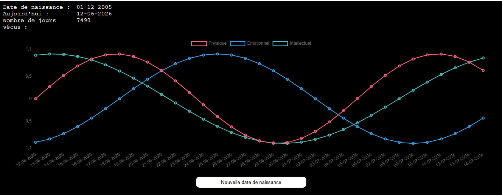
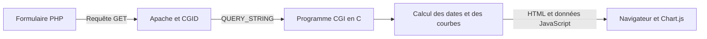
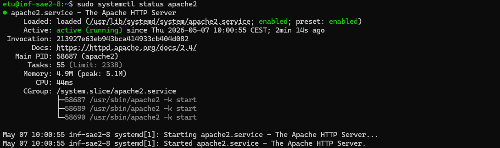

# Serveur LAMP et application Biorythmes


Installation et configuration d'un serveur LAMP sous Debian, puis déploiement d'une application web utilisant un programme CGI en C. Le projet relie l'administration Linux, la configuration d'Apache, la gestion des droits et la génération de graphiques dans le navigateur.

L'application reçoit une date de naissance et une durée d'affichage, calcule trois séries sinusoïdales et les représente avec Chart.js. Les biorythmes servent ici de support à l'exercice de programmation et de déploiement.

## 🖥️ Aperçu



*Capture réalisée lors du projet : trois courbes, une durée paramétrable et un retour au formulaire.*

## 👤 Ma réalisation

J'ai réalisé ce projet individuellement : installation et configuration des services, adaptation et complétion des programmes CGI fournis, développement de la version finale, tests sur le serveur et rédaction du guide. J'ai également présenté le fonctionnement de l'environnement et de l'application lors d'une démonstration orale.

Ce projet m'a permis de travailler l'administration d'un serveur Linux à distance, la gestion des services et des permissions, le diagnostic d'erreurs de déploiement et la communication entre un formulaire web et un programme C.

## 🛠️ Technologies et outils

| Technologie ou outil | Utilisation |
| --- | --- |
| Debian 13, APT, systemd | Environnement serveur, installation des paquets et contrôle des services |
| Apache 2 | Serveur HTTP, répertoires utilisateurs avec UserDir et exécution CGI avec CGID |
| MariaDB et phpMyAdmin | Installation du service de base de données et de son interface d'administration |
| PHP | Formulaire web et vérification de la configuration de l'interpréteur |
| C, GCC et Make | Traitement des paramètres, calcul des dates et compilation du programme CGI |
| JavaScript et Chart.js | Affichage des courbes dans le navigateur |
| SSH, SCP et VS Code Remote SSH | Connexion distante, transfert des fichiers et édition sur le serveur |

## 🔗 Fonctionnement



MariaDB et phpMyAdmin font partie de l'environnement LAMP installé. Le programme de calcul ne consulte pas de base de données : il travaille à partir des paramètres de la requête et de la date du serveur.

La version finale génère les tableaux JavaScript directement dans la réponse HTML. Elle n'écrit plus les résultats dans le fichier `data.js` partagé utilisé par la version précédente, ce qui évite l'écrasement de ce fichier entre plusieurs requêtes.

## ⚙️ Installation et diagnostic

Le [guide illustré](docs/guide-installation.pdf) présente la configuration des services, l'accès distant, les permissions et le déploiement de l'application. Il comprend notamment :

- l'installation et la vérification d'Apache, MariaDB, PHP et phpMyAdmin ;
- la création d'un utilisateur et de son répertoire `public_html` ;
- l'activation de UserDir et de l'exécution des programmes CGI ;
- la résolution d'erreurs d'accès HTTP 403 et de configuration de phpMyAdmin ;
- la compilation, le déploiement et les essais de l'application.



## 🧩 Évolution du programme

| Version | Fonctionnement |
| --- | --- |
| V1 | Réponse HTML statique pour vérifier l'exécution CGI |
| V2 | Lecture des paramètres GET et calcul du nombre de jours écoulés |
| V3 | Génération des courbes dans un fichier JavaScript, avec gestion du calendrier |
| V4 | Nombre de jours paramétrable et génération des données dans la réponse HTML |

Le module `fonctions.c` regroupe les opérations sur les dates, notamment la validation du jour et du mois, les années bissextiles et le passage d'un mois ou d'une année à l'autre.

## ▶️ Compiler et examiner la réponse CGI

Depuis la racine du dépôt, sur Linux avec GCC :

```bash
mkdir -p build
gcc src/biorythmeV4.c src/fonctions.c -o build/biorythme.cgi -lm
QUERY_STRING='jour=1&mois=1&an=2000&nbJours=33' ./build/biorythme.cgi > build/reponse-cgi.txt
```

Le fichier obtenu contient l'en-tête CGI puis le HTML et les données JavaScript. Cette commande permet d'examiner la réponse du programme ; pour utiliser le formulaire et afficher les courbes, il faut configurer Apache et PHP et placer les ressources web aux emplacements attendus.

Le `Makefile` d'origine, conservé dans `src/`, compile directement vers `/home/info/public_html/cgi-bin/biorythme.cgi`. Son utilisation suppose donc que cette arborescence existe et que le compte de compilation dispose des droits nécessaires.

Ces commandes reprennent la compilation du Makefile en plaçant le résultat dans un dossier local `build/`. Elles permettent de comprendre et de reprendre le programme sans utiliser les chemins du serveur d'origine.

## 📌 Points à connaître

Les sources C et le Makefile sont conservés tels qu'ils ont été rendus. Le bouton de retour de la V4 contient l'adresse du serveur utilisé pendant le projet ; cette adresse doit être adaptée pour un autre hébergement. La V4 charge également Chart.js depuis un CDN.

Le serveur du projet n'est plus disponible. Les captures présentent le fonctionnement obtenu à l'époque ; les anciennes adresses du guide ne constituent pas une démonstration en ligne.

Le dossier `web/Biorythme/` contient les ressources fournies au départ dans le sujet. Le formulaire final, visible page 28 du guide, ajoutait le champ `nbJours`. Ce fichier modifié n'étant pas présent dans l'archive du rendu, le formulaire initial est conservé : il transmet la date, et la V4 utilise alors sa durée par défaut de 33 jours. Le nombre de jours peut aussi être transmis directement dans la requête, comme dans l'exemple ci-dessus.

Le contrôle des entrées reste à renforcer avant une mise en service publique : paramètres manquants ou non numériques, dates de naissance futures et limite du nombre de jours à calculer. Le test d'une date impossible ne couvre pas l'ensemble de ces cas.

Les captures du guide documentent les essais réalisés sur le serveur pendant le projet. Le dépôt n'inclut pas une image de cette machine ni un script automatisant son installation.

### Précisions de lecture du guide

Le guide est conservé tel qu'il a été rendu. Pour reprendre son installation, trois points méritent une précision :

- **Page 15 :** la création de `info.php` nécessite `echo '<?php phpinfo(); ?>' > /home/info/public_html/info.php`, exécuté en tant que root. `chown` sert à changer le propriétaire, pas à écrire le contenu du fichier.
- **Pages 29 et 30 :** l'écriture par un programme web ne nécessite pas `chmod 777`. Les permissions doivent être accordées au compte et au groupe concernés. Le passage à `775` retire l'écriture aux autres utilisateurs ; il ne garantit pas à lui seul la sécurité de l'application. Le choix du propriétaire du binaire dépend également de l'organisation du déploiement.
- **Pages 27 à 29 :** la V4 supprime l'écriture du fichier de données partagé. Aucun comparatif chronométré n'est fourni pour quantifier un gain de performances. Le rejet d'une date impossible documente un cas de validation, sans garantir le traitement de toutes les entrées incorrectes.

## 📂 Contenu du dépôt

```text
src/                    Sources C et Makefile du rendu
web/Biorythme/          Interface et ressources web
docs/guide-installation.pdf
docs/guide-installation.docx
docs/images/            Captures du projet
```

## 📚 Ressources

Le projet s'appuie sur les ressources de départ fournies par Bruno ERNET. Les mentions d'auteur présentes dans les sources sont conservées. Chart.js est une bibliothèque tierce utilisée pour le tracé des courbes.

- [Documentation Apache : exécution de programmes CGI](https://httpd.apache.org/docs/2.4/howto/cgi.html)
- [Documentation Apache : répertoires utilisateurs](https://httpd.apache.org/docs/2.4/howto/public_html.html)

Berat DASTAN
